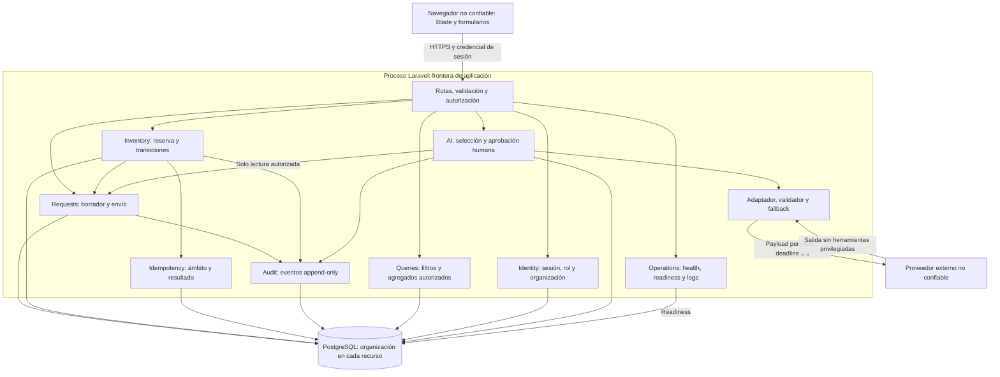

# Componentes y fronteras — propuesta G2

Todos los módulos comparten proceso Laravel y una base; los bloques no son microservicios. Flechas indican llamadas o acceso autorizado. ADR-001 define dependencias; ADR-002/003 pendientes concretan transacción y sesión.

La persistencia AI solo guarda resumen/aprobación/intento, no inventario. Requests/Inventory/Idempotency/Audit deben usar la misma transacción para cada transición; no llamadas HTTP internas ni colas para confirmar stock. Logs de rechazos son técnicos, no eventos de transición exitosa. Readiness no llama al LLM, por lo que un proveedor caído no impide usar el sistema. Identidad y filtros se aplican antes del replay idempotente. Texto IA se escapa en la UI.
