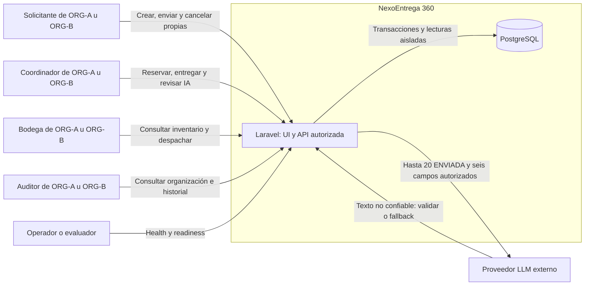

# Contexto — propuesta G2

ADR-001; RF01–12. G1 y G2 sin aprobación. API/Blade y PostgreSQL dentro del sistema; proveedor externo sin privilegios. Datos y credenciales ficticios para demo.

Toda petición lleva identidad del servidor y alcance de organización; los usuarios no acceden directamente a PostgreSQL o al proveedor. CL-16/17/18 no amplían los permisos mostrados. El evaluador consulta operación sin recibir secretos. No hay prueba de despliegue ni rendimiento asociada todavía.
