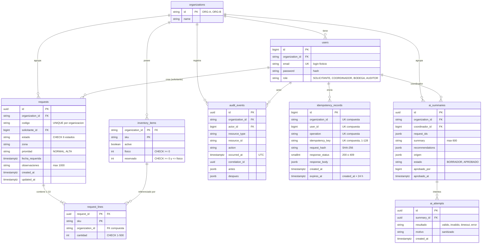

# Modelo de datos — G2

Vista de datos exigida por el enunciado §6. Motor: PostgreSQL (ADR-001). Restricciones transaccionales en [ADR-002](../adr/ADR-002-transacciones-idempotencia.md); tablas del asistente en [ADR-004](../adr/ADR-004-integracion-ia-degradacion.md). Nombres de tablas y columnas orientativos para las migraciones de Laravel.

## Restricciones e índices

| Tabla | Restricción | Requisito |
|---|---|---|
| `inventory_items` | `CHECK (fisico >= 0 AND reservado >= 0 AND reservado <= fisico)`; disponible = fisico − reservado se calcula, no se guarda | RF05, RNF02 |
| `requests` | `CHECK (estado IN ('BORRADOR','ENVIADA','RESERVADA','DESPACHADA','ENTREGADA','CANCELADA'))`; `CHECK (prioridad IN ('NORMAL','ALTA'))`; `UNIQUE (organization_id, codigo)`; `UNIQUE (id, organization_id)` para la FK compuesta | RF03, RF04 |
| `request_lines` | `PRIMARY KEY (request_id, sku)` (sin SKU repetidos); `CHECK (cantidad BETWEEN 1 AND 500)`; FK `(request_id, organization_id)` → `requests`; FK `(organization_id, sku)` → `inventory_items` | RF02, RF03 |
| `audit_events` | Trigger que rechaza `UPDATE` y `DELETE`; índice `(organization_id, resource_id, occurred_at)` | RF09 |
| `idempotency_records` | `UNIQUE (organization_id, user_id, operation, idempotency_key)`; índice en `expires_at` para la limpieza | RF07 |
| Todas las de negocio | `organization_id` obligatorio; toda consulta filtra por la organización de la identidad | RF02 |

Las restricciones no sustituyen las validaciones de la aplicación (que devuelven 422 o 409 con mensaje claro); son una segunda barrera que impide datos imposibles aunque haya un error de código.

## Correspondencia con el contrato y el seed

| Contrato (`openapi.yaml`) | Columna |
|---|---|
| `Solicitud.codigo`, `estado`, `zona`, `prioridad`, `fechaRequerida`, `observaciones` | `requests.*` |
| `LineaSolicitud.sku`, `cantidad` | `request_lines.*` |
| `InventarioItem.fisico`, `reservado`, `disponible`, `activo` | `inventory_items.*` (disponible calculado) |
| `EventoAuditoria.actorId`, `organizationId`, `resourceId`, `action`, `occurredAt`, `correlationId` | `audit_events.*` |

El seed pequeño traduce `fixture-scenarios.json`: 2 organizaciones, 8 usuarios, 6 filas de inventario (por ejemplo, ORG-A KIT-ALIMENTO 10/0) y las solicitudes A-001, A-002 y B-001. El seed de carga de 2.000 solicitudes es independiente (§12).
