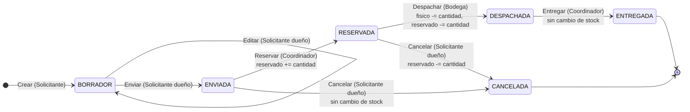

# Estados de la solicitud — G2

Vista de estados exigida por el enunciado §6. Reglas de RF04 y RF06 y actores del §2. Implementación transaccional en [ADR-002](../adr/ADR-002-transacciones-idempotencia.md).

## Matriz de transiciones

Cualquier combinación que no aparezca como permitida responde **409** y conserva datos, inventario y auditoría (RF04). Un rol sin permiso sobre una solicitud de su organización recibe **403**; una solicitud de otra organización, **404** (§2).

| Desde \ Acción | Editar | Enviar | Reservar | Despachar | Entregar | Cancelar |
|---|---|---|---|---|---|---|
| BORRADOR | ✅ | ✅ | 409 | 409 | 409 | 409 |
| ENVIADA | 409 | 409 | ✅ | 409 | 409 | ✅ |
| RESERVADA | 409 | 409 | 409 | ✅ | 409 | ✅ |
| DESPACHADA | 409 | 409 | 409 | 409 | ✅ | 409 |
| ENTREGADA | 409 | 409 | 409 | 409 | 409 | 409 |
| CANCELADA | 409 | 409 | 409 | 409 | 409 | 409 |

## Efecto de cada transición permitida

Ejemplo con el oráculo oficial: KIT-ALIMENTO de ORG-A con físico 10 y A-001 de 7 unidades (físico / reservado / disponible).

| Transición | Actor | Antes | Después | Evento de auditoría |
|---|---|---|---|---|
| Enviar | Solicitante dueño | 10 / 0 / 10 | 10 / 0 / 10 | Sí |
| Reservar | Coordinador | 10 / 0 / 10 | 10 / 7 / 3 | Sí |
| Despachar | Bodega | 10 / 7 / 3 | 3 / 0 / 3 | Sí |
| Entregar | Coordinador | 3 / 0 / 3 | 3 / 0 / 3 | Sí |
| Cancelar desde ENVIADA | Solicitante dueño | 10 / 0 / 10 | 10 / 0 / 10 | Sí |
| Cancelar desde RESERVADA | Solicitante dueño | 10 / 7 / 3 | 10 / 0 / 10 | Sí |

Los estados ENTREGADA y CANCELADA son finales. Editar solo es posible en BORRADOR. Las pruebas de AC-03-07 recorren todas las celdas 409 de la matriz.
