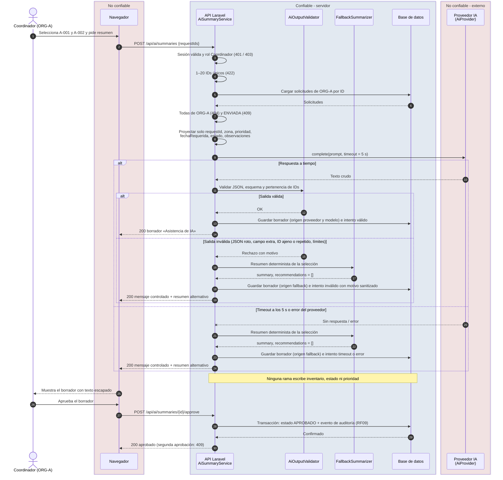

# Secuencia: consulta de IA con fallo

Diagrama exigido por el enunciado §6 («consulta de IA con fallo»). Decisión de diseño en [ADR-004](../adr/ADR-004-integracion-ia-degradacion.md). Fronteras de confianza: el navegador y el proveedor de IA son **no confiables**; la API y la base de datos son confiables.

## Lectura del diagrama

| Paso | Requisito | Qué garantiza |
|---|---|---|
| 3–7 | RF02, RF10, CL-19 | Rechazos 401, 403, 422, 404 y 409 antes de llamar al proveedor |
| 8 | RF10 | El proveedor recibe solo los seis campos autorizados |
| 9 | RF12 | Plazo de 5 s |
| Rama «salida inválida» | RF11 | El esquema y la pertenencia se validan en el servidor; el texto del modelo no se ejecuta |
| Rama «timeout o error» | RF12, RNF06 | Mensaje controlado y resumen determinista; el resto del sistema sigue funcionando |
| Nota | RF12, §10 | El modelo nunca escribe inventario ni invoca operaciones privilegiadas |
| Aprobación | RF09, RF12 | Evento de auditoría en la misma transacción; sin efectos sobre el negocio |

El diagrama debe coincidir con el código entregado (§6); si la implementación cambia, se actualiza en el mismo PR.
