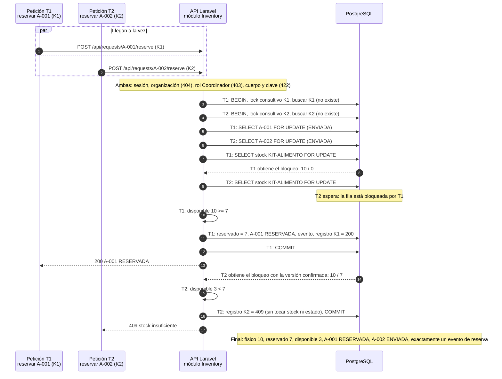

# Secuencia: reserva concurrente

Diagrama exigido por el enunciado §6 («reserva concurrente»). Decisión en [ADR-002](../adr/ADR-002-transacciones-idempotencia.md). Escenario del oráculo oficial: KIT-ALIMENTO de ORG-A con físico 10 y reservado 0; A-001 y A-002, ambas ENVIADA con 7 unidades, se reservan al mismo tiempo con claves distintas K1 y K2. No se fija cuál gana; el diagrama muestra el caso en que T1 obtiene primero el bloqueo del stock.

## Por qué es correcto

| Riesgo | Cómo lo evita el diseño |
|---|---|
| Ambas reservas exitosas (doble promesa de stock) | La fila de stock se bloquea con `FOR UPDATE`; T2 solo puede leerla después de que T1 confirma, y en READ COMMITTED recibe la versión ya actualizada (reservado 7) |
| Reserva parcial con varias líneas | Todas las filas se comprueban antes de escribir; si alguna falla, no se modifica ninguna (RF05) |
| Deadlock entre dos solicitudes con varios SKU | Todas las transacciones bloquean en el mismo orden: solicitud y luego stock por SKU ascendente |
| Mismo pedido enviado dos veces con la misma clave | El bloqueo consultivo de la clave serializa ambas; la segunda encuentra el registro y repite la respuesta sin nuevos efectos |
| Fallo a mitad de la transacción | `ROLLBACK` total; ni stock, ni estado, ni evento, ni registro de idempotencia (AC-03-09) |

## Cómo se prueba (AC-03-03 y AC-03-08)

1. Restablecer el seed (10 / 0; A-001 y A-002 ENVIADA).
2. Lanzar dos procesos reales que esperan en una barrera y envían las dos reservas a la vez.
3. Oráculo escrito antes: una respuesta 200 y una 409 (sin importar cuál), stock 10 / 7 / 3 y un solo evento de reserva, comprobado con una consulta directa a PostgreSQL.
4. Repetir al menos 20 veces con datos limpios; cualquier repetición con dos 200 o reservado distinto de 7 es un defecto.
